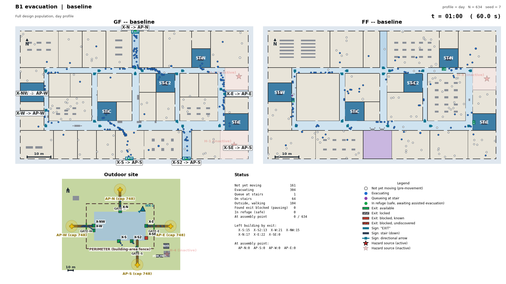

# Disaster Management System

An agent-based evacuation simulator for an industrial plant with toxic-gas
hazards. It models a multi-storey building and its outdoor site at the cell,
graph and continuous-field level, then runs hundreds of simulated occupants
— with different body sizes, speeds and abilities — through an evacuation,
including scenarios where an exit is blocked and agents have to discover
that and re-route.

The environment is built entirely from a declarative YAML description (no
building IDs, coordinates or room counts hard-coded anywhere), so new
buildings and sites can be added without touching the simulation code.

## Features

- **Multi-resolution geometry.** Floors, rooms, corridors, doors, stairs,
  exits, windows and obstacles defined in YAML; rasterised at two
  resolutions (0.5 m occupancy grid, 0.2 m fine grid for routing), plus a
  routing graph for A* and Eikonal (fast-marching) travel-time fields for
  every floor.
- **Realistic large building fixture ("B1-L").** 96 × 54 m, two floors
  (48 ground-floor + 35 first-floor spaces), 91 doors/openings, 5 stairs,
  7 exits. Validated against building-code style checks:
  - ground-floor max travel distance to an exit: **52.6 m** (limit 61 m
    unsprinklered / 91 m sprinklered)
  - first-floor max distance to the nearest enclosed stair: **48.4 m**
    (same limits)
  - narrowest door: **0.85 m clear** (code minimum 0.81 m)
  - stair width capacity: 1,132 person-equivalents vs. a worst-floor
    design load of 451
  - exit width capacity: 2,000 person-equivalents
- **Redundancy checking.** Automated single- and double-failure sweeps
  (any one door, corridor segment, stair, exit, gate, or outdoor walkway
  closed) confirm every room keeps at least one route to an exit, and every
  building exit keeps at least two working routes to an assembly point.
- **Heterogeneous bodies.** Four body classes (standard, large,
  mobility-aid user, wheelchair user), each with its own clearance radius;
  routing, door/exit passability and corridor width are all computed per
  class, not for one fixed body size.
- **Areas of refuge and exit signage.** Refuge areas next to enclosed
  stairs for occupants who can't use stairs, and rule-generated directional
  signage at every exit, stair door, and corridor junction or turn —
  verified to always lead to an available exit, never into a dead end.
- **Realistic outdoor site.** Walkways, a perimeter fence with gates,
  plant structures (pipe rack, tanks, an adjacent building), parking, and
  sized assembly-point areas, connected by a real outdoor A* graph (not a
  straight-line shortcut) that the evacuation walker actually routes
  through.
- **Vectorised evacuation walker.** Hundreds of agents stepped together
  (numpy), with pre-movement delay, exit/stair capacity queues, and a
  belief-vs-truth field switch so agents only re-route around a blocked
  exit once they're close enough to discover it. A 634-agent full-population
  run reaches 0 stuck agents in the baseline scenario; in the compound
  scenario, 181 agents discover a hidden blocked exit and successfully
  re-route.
- **Hazard scenarios.** A reusable scenario layer resolves wind, release
  rate and timing for named hazard sources, with fixed or randomly sampled
  ranges (reproducible by seed), ready for the dispersion model that plugs
  in next.
- **Presentation-ready rendering.** A 16:9 layout (1080p previews, 4K for
  pitch videos) with side-by-side floor plans, a live outdoor site map,
  a status panel, and a legend — true-scale exits, rooms, and agent bodies,
  colour-blind-safe palette.



## Setup

```
python -m venv .venv
.venv\Scripts\activate        # Windows
pip install -r requirements.txt
```

Python 3.11+ recommended.

## Running the tests

```
python -m pytest -q -m "not slow"   # fast suite, for everyday edits
python -m pytest -q                 # full suite, including multi-hundred-agent runs
python -m ruff check dms tests      # linting
```

## Running the demo

Build a building's environment artifacts (grids, navigation graph, outdoor
network):

```
python -m dms.tools.build_env --config configs/buildings/two_storey_large.yaml --out-dir out --visualize
```

Render an evacuation demo (video + a `frames.json` export for the web
player):

```
python -m dms.viz.render_b1l_demo --scenario baseline --out-dir out
```

See `docs/build_env.md` for the exact shape of the build artifacts.

## Project structure

```
configs/            Building and site YAML, agent/visual config defaults
dms/
  geometry/          Building/site primitives, loader, validators, code checks
  grid/              Rasterisation, occupancy layers, cell-level redundancy
  graph/             L2 navigation graph, A*, redundancy sweeps
  fields/            Eikonal travel-time fields, outdoor FMM fields
  scenario/          Population sampling, hazard scenarios, the evacuation walker
  viz/               Rendering: floor plans, site map, status panel, video export
  tools/             CLI entry points (build_env, converters)
tests/               Unit and integration tests, by module
out/                 Generated reports (committed) and renders (not committed)
docs/                Reference docs (build artifact format, SYSTEM_SPEC.md)
```

## Roadmap

The environment (this codebase) is complete and the focus going forward is
the agent decision layer:

- **Social-force agent physics** using the body classes already in the
  environment, plus perception and limited information sharing between
  nearby agents.
- **Decentralised, autonomous indoor routing** — no central indoor
  controller. Unfamiliar agents explore and backtrack at junctions; a
  shared, trait-conditioned reinforcement-learning policy (trained across
  many generated buildings) eventually replaces the rule-based baseline at
  decision points.
- **Guided outdoor evacuation** — agents reach an assembly point either by
  supervised A* routing (hazard- and crowding-aware) or by following a
  nearby authority figure.
- **Toxic-gas dispersion** — indoor H₂S transport and outdoor wind-driven
  plume modelling, feeding into hazard-aware exit and assembly-point choice.
- **Scale-up** to a full-plant, multi-building simulation with thousands of
  agents.

## Technical reference

`SYSTEM_SPEC.md` is the binding physics and parameter specification
(coordinate frames, clocks, kinematic models, source citations) that this
implementation follows.
